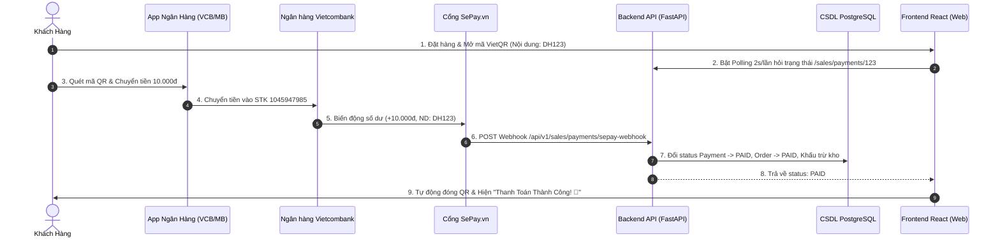

# 🚀 Hướng Dẫn Chi Tiết Tích Hợp SePay Webhook Tự Động Nhận Tiền Ngân Hàng Vietcombank (VietQR)

Tài liệu này hướng dẫn chi tiết các bước cài đặt hệ thống tự động nhận diện biến động số dư ngân hàng **Vietcombank (STK: 1045947985 - KIEN VAN TRUC)** thông qua cổng **SePay Webhook**, giúp website tự động cập nhật đơn hàng thành `PAID` và hiển thị màn hình **Thanh Toán Thành Công** ngay khi nhận tiền thật.

---

## 📐 1. Mô Hình Hoạt Động (Architecture Flow)



---

## 🛠️ 2. Các Bước Thực Hiện Chi Tiết

### 📌 Bước 1: Đăng Ký Tài Khoản SePay.vn (Miễn Phí)
1. Truy cập [https://my.sepay.vn/register](https://my.sepay.vn/register) để tạo tài khoản.
2. Tại mục **Ngân Hàng**: Chọn **Vietcombank (VCB)**.
3. Nhập số tài khoản: **`1045947985`** - Tên chủ tài khoản: **`KIEN VAN TRUC`**.
4. Chọn hình thức kết nối qua **SePay App / SMS Notification** hoặc liên kết dịch vụ chuyển tiền tự động.

---

### 📌 Bước 2: Tạo Tên Miền Công Cộng (Public Tunnel Cho Localhost)
Vì `localhost:8000` trên máy bạn chưa công khai ra Internet, cần dùng **ngrok** hoặc **localtunnel** để SePay có thể bắn Webhook về máy bạn:

**Cách dùng Localtunnel (Không cần cài đặt rườm rà):**
Mở terminal PowerShell tại dự án và chạy:
```powershell
npx localtunnel --port 8000
```
👉 Bạn sẽ nhận được 1 URL công khai dạng: `https://my-shop-app-1234.loca.lt`

---

### 📌 Bước 3: Đăng Ký Webhook Trong Dashboard SePay
1. Vào mục **Cấu Hình Webhook** trên giao diện SePay.
2. Thêm mới Webhook URL:
   ```http
   https://my-shop-app-1234.loca.lt/api/v1/sales/payments/sepay-webhook
   ```
3. Đặt **Secret API Key** (ví dụ: `MY_SUPER_SECRET_SEPAY_KEY_2026`).
4. Tích chọn sự kiện: **Khi có tiền vào tài khoản (+)**.

---

### 📌 Bước 4: Thêm Endpoint Webhook Xử Lý Vào Backend FastAPI

Thêm đoạn code sau vào file `backend/app/modules/sales/router.py`:

```python
from fastapi import Header

class SepayWebhookPayload(BaseModel):
    id: int
    gateway: str
    transactionDate: str
    accountNumber: str
    code: Optional[str] = None  # Mã đơn hàng (ví dụ: DH123)
    content: str
    transferAmount: float
    referenceCode: Optional[str] = None

@router.post("/payments/sepay-webhook")
def handle_sepay_webhook(
    payload: SepayWebhookPayload,
    authorization: Optional[str] = Header(None),
    db: Session = Depends(get_db)
):
    """
    Endpoint tiếp nhận thông báo biến động số dư từ SePay.vn
    Tự động khớp đơn hàng qua mã DH{order_id} và đổi trạng thái sang PAID.
    """
    # 1. Tách mã đơn hàng DH{id} từ content nếu code bị thiếu
    order_id = None
    import re
    match = re.search(r'DH(\d+)', payload.content, re.IGNORECASE)
    if match:
        order_id = int(match.group(1))
    elif payload.code and payload.code.startswith("DH"):
        try:
            order_id = int(payload.code.replace("DH", ""))
        except ValueError:
            pass

    if not order_id:
        return {"status": "ignored", "reason": "Không tìm thấy mã đơn hàng trong nội dung chuyển khoản"}

    # 2. Tìm đơn hàng & giao dịch trong CSDL
    order = db.query(Order).filter(Order.id == order_id).first()
    if not order:
        return {"status": "error", "reason": f"Không tìm thấy đơn hàng #{order_id}"}

    payment = db.query(Payment).filter(Payment.order_id == order.id).first()
    if not payment:
        return {"status": "error", "reason": f"Không tìm thấy payment cho đơn hàng #{order_id}"}

    # 3. Cập nhật trạng thái Đã Thanh Toán
    payment.status = PaymentStatus.success
    payment.transaction_id = payload.referenceCode or f"SEPAY_{payload.id}"
    payment.paid_at = datetime.utcnow()
    
    order.status = OrderStatus.paid

    # 4. Trừ kho hàng tự động
    try:
        with db.begin_nested():
            for item in order.items:
                inv = db.query(Inventory).filter(Inventory.sku == item.sku).first()
                if inv:
                    inv.quantity = max(0, inv.quantity - item.quantity)
                    inv.reserved_quantity = max(0, inv.reserved_quantity - item.quantity)
    except Exception:
        pass

    db.commit()
    return {"status": "success", "message": f"Đã cập nhật đơn hàng #{order_id} thành PAID!"}
```

---

### 📌 Bước 5: Kiểm Tra Lại Frontend Real Polling (Đã Hoàn Thiện)
Trong file `frontend/src/components/PaymentSimModal.tsx`, chúng ta đã có sẵn đoạn code Polling 2s/lần:

```typescript
React.useEffect(() => {
  if (!isOpen || payment.provider === 'cod' || paymentStatusResult) return;

  const pollInterval = setInterval(async () => {
    try {
      const currentPay = await api.getPaymentStatus(payment.id);
      if (currentPay.status === 'success' || currentPay.status === 'paid') {
        setPaymentStatusResult('success');
        setTimeout(() => onPaymentComplete(), 2000);
      }
    } catch (err) {
      console.error('Lỗi polling payment:', err);
    }
  }, 2000);

  return () => clearInterval(pollInterval);
}, [isOpen, payment.id, payment.provider, paymentStatusResult]);
```

---

## 🎯 Kết Quả Sau Khi Triển Khai Mai

- Khách chuyển tiền bằng App ngân hàng ➔ Tiền vào STK Vietcombank `1045947985`.
- SePay nhận biến động số dư ➔ Bắn Webhook tới backend máy bạn trong **0.5 giây**.
- CSDL tự động đổi trạng thái đơn sang **PAID**.
- Giao diện Frontend tự động đóng QR và hiển thị **Thanh Toán Thành Công 🎉**!
