# UML - SƠ ĐỒ TUẦN TỰ (Sequence Diagram) & SƠ ĐỒ LỚP (Class Diagram)
## Hệ thống bán hàng online + quản lý đa kênh

> Cú pháp **Mermaid**. Xem hình trực quan tại https://mermaid.live (dán từng khối code), hoặc mở bằng VSCode/Notion/Obsidian có hỗ trợ Mermaid.

---

# PHẦN 1: SƠ ĐỒ TUẦN TỰ (SEQUENCE DIAGRAM)

## 1.1. Đăng ký / Đăng nhập + Refresh Token

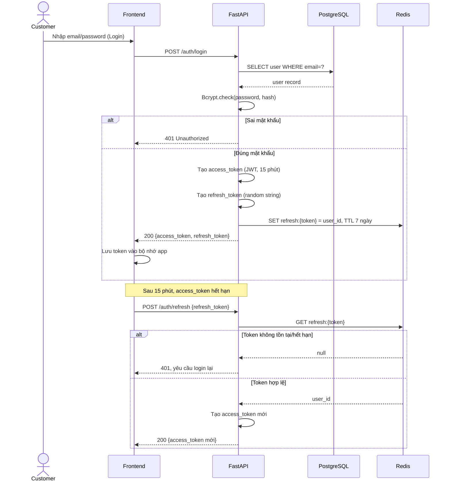

---

## 1.2. Đặt hàng - Giữ chỗ tồn kho (Idempotency + Redis)

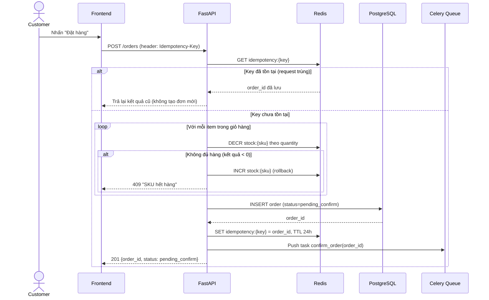

---

## 1.3. Celery Worker xác nhận đơn (trừ kho thật)

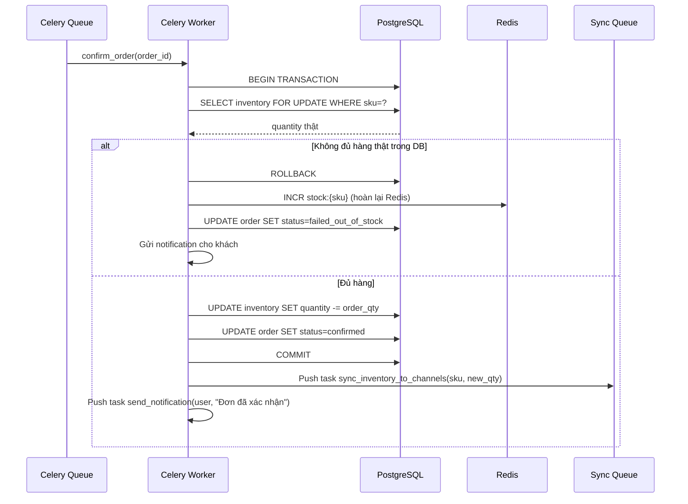

---

## 1.4. Đồng bộ tồn kho sang Shopee/Lazada

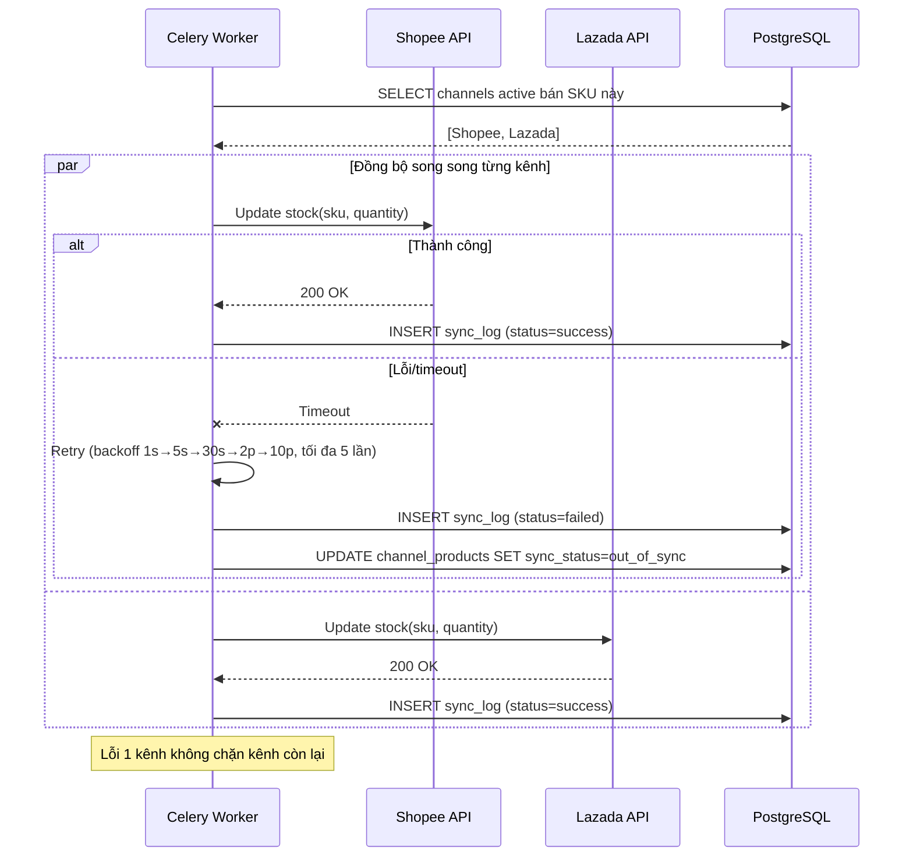

---

## 1.5. Nhận Webhook đơn hàng từ Shopee

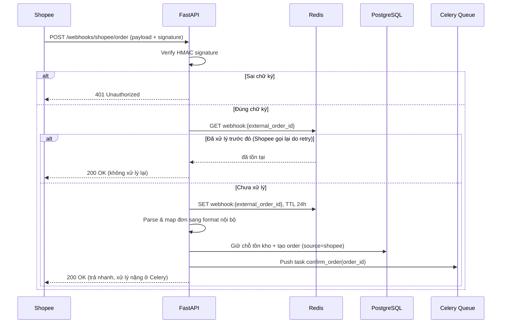

---

## 1.6. Thanh toán + Callback

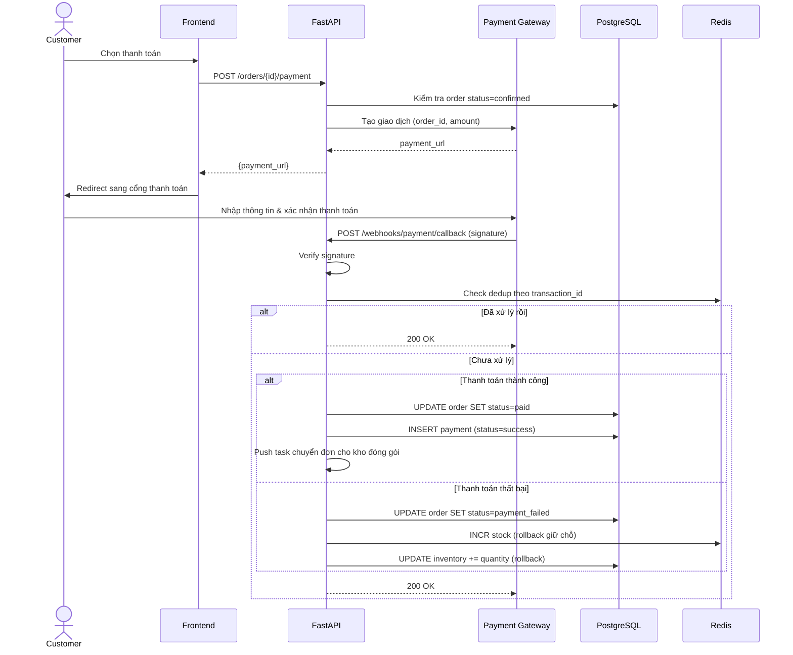

---

## 1.7. Nhập kho (Warehouse Staff)

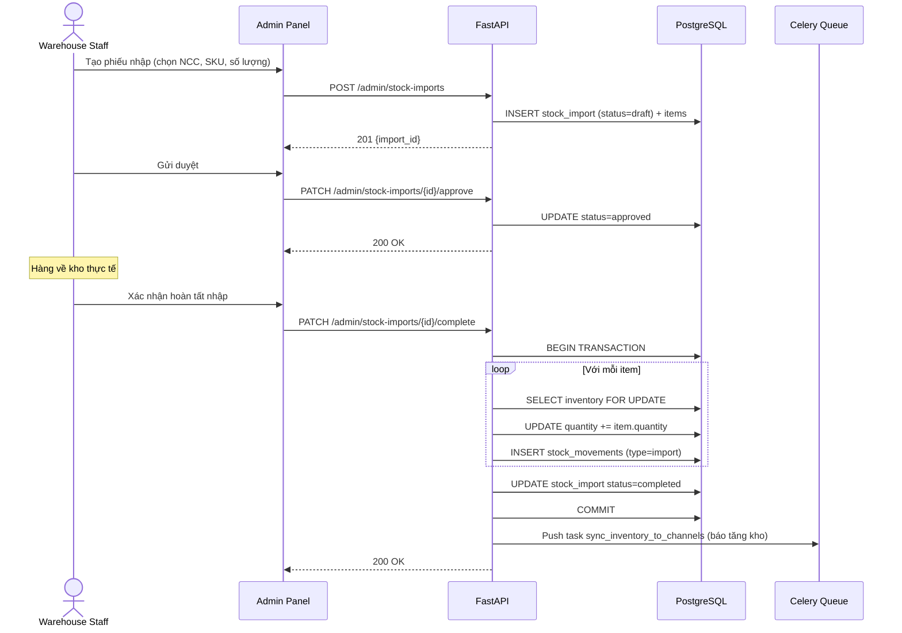

---

## 1.8. Đánh giá sản phẩm (Review)

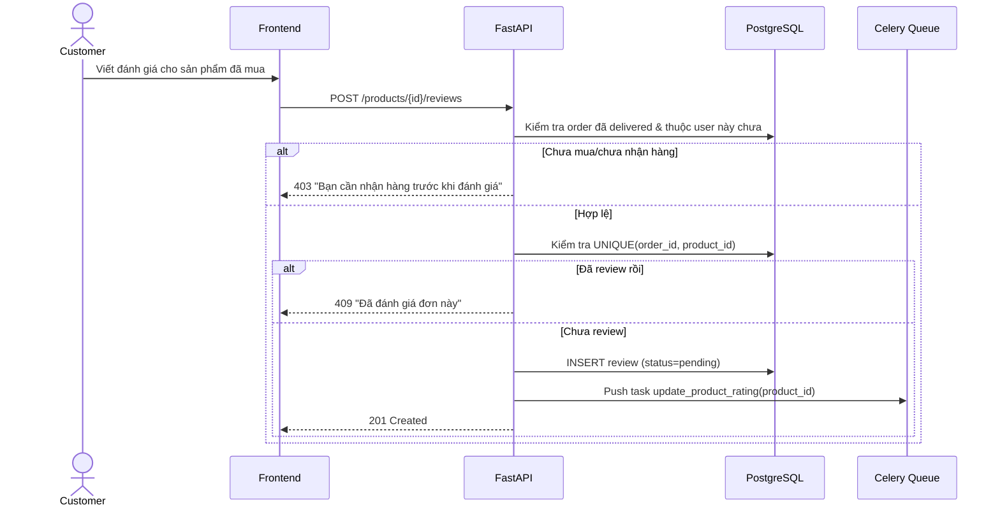

---

# PHẦN 2: SƠ ĐỒ LỚP (CLASS DIAGRAM)

## 2.1. Nhóm Người dùng & Phân quyền

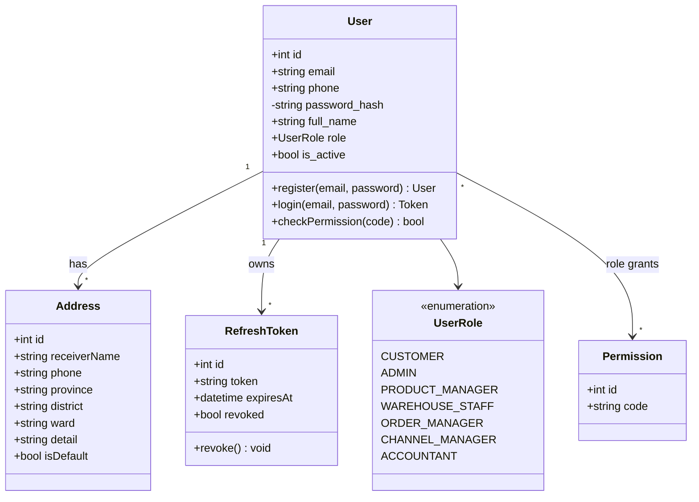

---

## 2.2. Nhóm Sản phẩm & Tồn kho

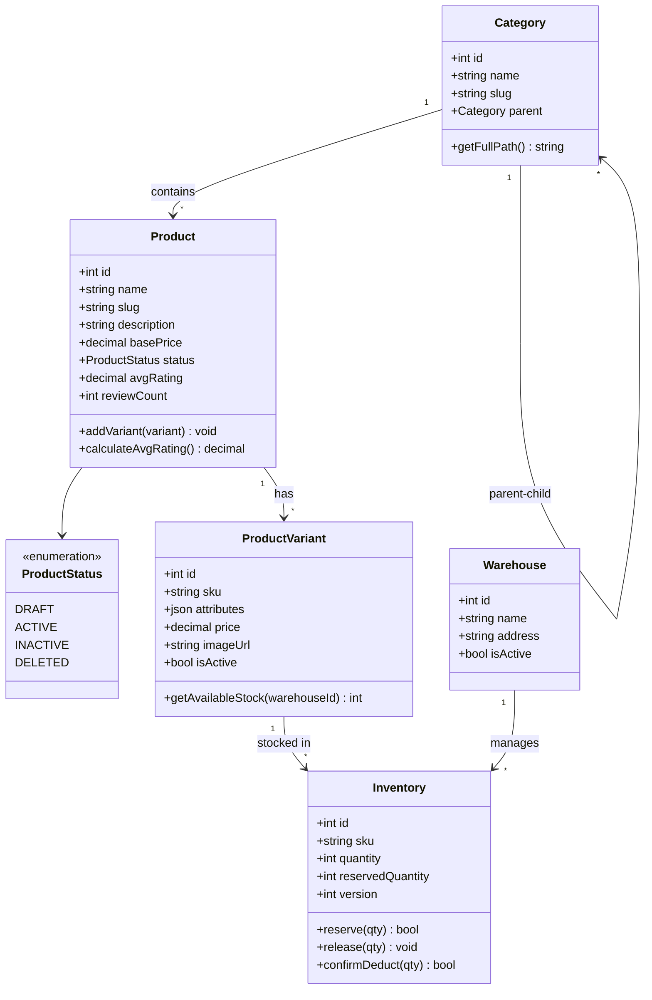

---

## 2.3. Nhóm Đơn hàng & Giỏ hàng

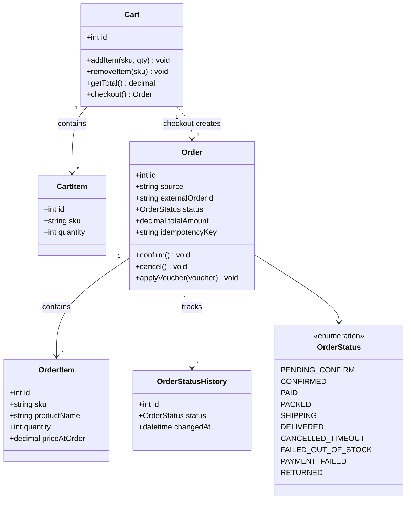

---

## 2.4. Nhóm Thanh toán, Vận chuyển & Đa kênh

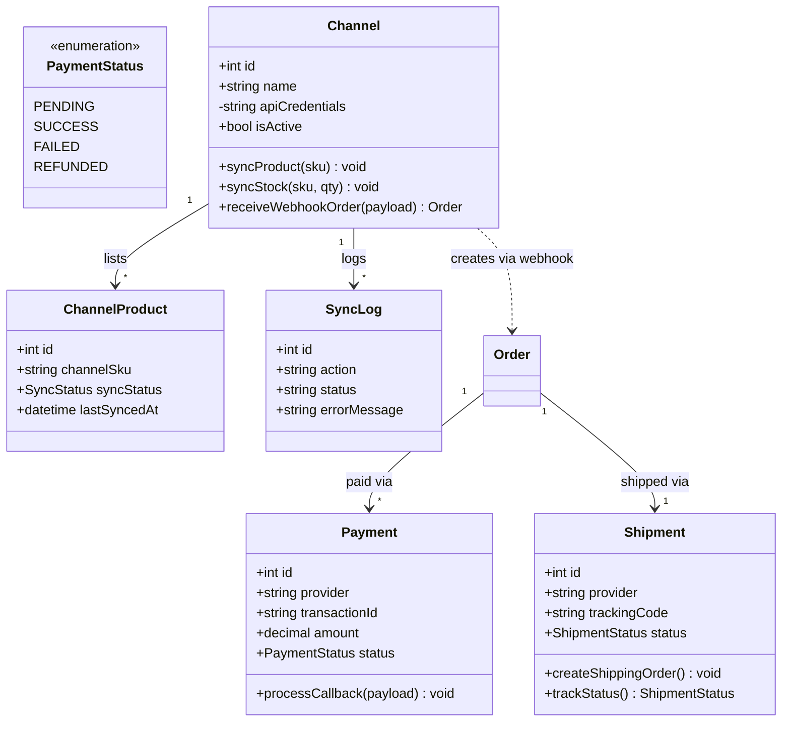

---

## 2.5. Nhóm Nhập/Xuất kho & Nhân sự

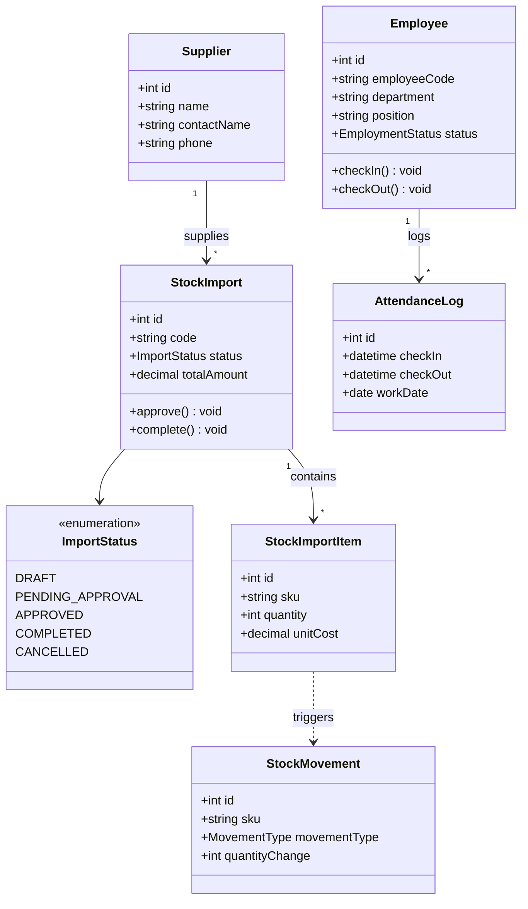

---

## 2.6. Nhóm Khuyến mãi & Đánh giá

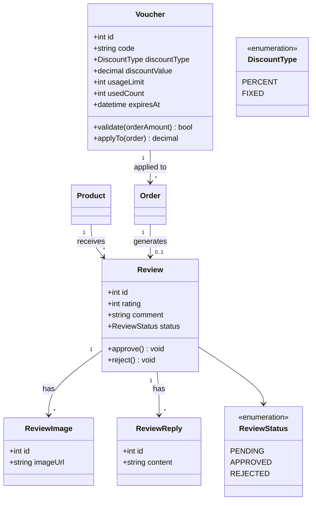

---

## Ghi chú ký hiệu Mermaid

**Sequence Diagram:**
| Ký hiệu | Ý nghĩa |
|---|---|
| `->>` | Gọi đồng bộ (request) |
| `-->>` | Trả về (response) |
| `--x` | Lỗi/timeout |
| `alt/else` | Rẽ nhánh điều kiện |
| `loop` | Lặp |
| `par/and` | Chạy song song |
| `Note over` | Ghi chú |

**Class Diagram:**
| Ký hiệu | Ý nghĩa |
|---|---|
| `+` | public |
| `-` | private |
| `"1" --> "*"` | Quan hệ 1 - nhiều |
| `..>` | Quan hệ phụ thuộc (dependency) |
| `<<enumeration>>` | Kiểu liệt kê (enum) |

**Cách xem hình:** copy từng khối ` ```mermaid ` dán vào https://mermaid.live để render trực quan ngay.
