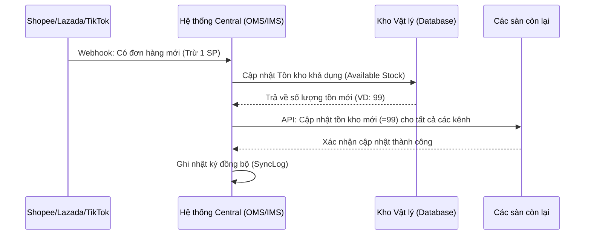

# Tài liệu Thiết kế Hệ thống Toàn diện: OMS, IMS, PMS & CRM

Tài liệu này mô tả chi tiết kiến trúc và logic vận hành của hệ thống Quản lý bán hàng đa kênh, bao gồm các phân hệ cốt lõi: **Sản phẩm (PMS)**, **Kho hàng (IMS)**, **Đơn hàng (OMS)**, **Khách hàng (CRM)** và **Tạo tài liệu**.

---

## 1. Hệ thống Quản lý Sản phẩm (PMS - Product Management System)

PMS là trung tâm dữ liệu hàng hóa, nơi quản lý thông tin gốc trước khi đẩy lên các sàn thương mại điện tử.

### 1.1 Khái niệm Master SKU (Mã SKU gốc)
- **Mã SKU gốc**: Mỗi sản phẩm vật lý có duy nhất một Master SKU.
- **Mapping (Ánh xạ)**: Một Master SKU có thể liên kết với nhiều SKU khác nhau trên các sàn (Shopee, Lazada, TikTok).
- **Lợi ích**: Khi cập nhật thông tin gốc, hệ thống có thể tùy chọn đồng bộ hàng loạt lên các sàn liên kết.

### 1.2 Quản lý Biến thể (Variants)
- Hỗ trợ đa thuộc tính (Màu sắc, Kích thước, Chất liệu).
- Mỗi biến thể có SKU riêng biệt nhưng thuộc cùng một "Sản phẩm cha".

---

## 2. Hệ thống Quản lý Kho (IMS - Inventory Management System)

IMS đảm bảo số lượng hàng tồn kho luôn chính xác trên tất cả các kênh bán hàng để tránh tình trạng "bán quá số lượng" (Overselling).

### 2.1 Logic Đồng bộ Tồn kho Thời gian thực (Real-time Sync)
Khi có biến động kho (có đơn hàng mới hoặc nhập kho), hệ thống thực hiện quy trình đồng bộ sau:

### 2.2 Các trạng thái Tồn kho
- **Tồn thực tế (On-hand)**: Tổng số lượng trong kho.
- **Tồn tạm giữ (Reserved)**: Hàng đã có đơn nhưng chưa đóng gói.
- **Tồn khả dụng (Available)**: `= Tồn thực tế - Tồn tạm giữ`. Đây là số lượng đẩy lên các sàn.
- **Tồn an toàn (Buffer Stock)**: Ngưỡng cảnh báo để chủ shop nhập hàng kịp thời.

---

## 3. Hệ thống Quản lý Đơn hàng (OMS - Order Management System)

OMS tập trung tất cả đơn hàng từ các nguồn về một màn hình duy nhất để xử lý tập trung.

### 3.1 Quy trình Xử lý Đơn hàng (Order Lifecycle)
1. **Chờ xác nhận**: Đơn mới từ sàn đổ về.
2. **Đã xác nhận**: Nhân viên đã kiểm tra thông tin và chốt đơn.
3. **Đang đóng gói**: Cập nhật trạng thái để chuẩn bị in vận đơn.
4. **Đang giao**: ĐVVC đã lấy hàng.
5. **Hoàn tất**: Khách đã nhận hàng.
6. **Hoàn hàng/Hủy**: Xử lý các trường hợp lỗi hoặc khách không nhận hàng.

### 3.2 Đối soát COD (Cash on Delivery)
- Tự động so khớp số tiền ĐVVC (GHN, GHTK...) thanh toán với số tiền dự kiến trên đơn hàng.
- Cảnh báo chênh lệch phí ship hoặc tiền thu hộ để chủ shop khiếu nại kịp thời.

---

## 4. Hệ thống Quản lý Khách hàng (CRM)

### 4.1 Hồ sơ Khách hàng Tập trung
- Lưu trữ lịch sử mua sắm từ tất cả các kênh (Ví dụ: Khách mua ở Shopee, sau đó inbox ở Fanpage vẫn nhận ra là khách cũ).
- Phân hạng khách hàng (Loyalty) dựa trên tổng chi tiêu.

### 4.2 Chat Đa kênh (Omnichannel Chat)
- Tích hợp cửa sổ chat từ Shopee, Lazada, Facebook vào một giao diện duy nhất.
- Hỗ trợ câu trả lời mẫu (Quick Reply) để tăng tốc độ tư vấn.

---

## 5. Hệ thống Tạo File Tài liệu & Báo cáo

### 5.1 Các loại tài liệu hỗ trợ
- **Phiếu đóng gói (Packing Slip)**: Danh sách sản phẩm cần nhặt cho mỗi đơn.
- **Vận đơn (Waybill)**: In trực tiếp từ API của ĐVVC hoặc mẫu tùy chỉnh cho máy in nhiệt.
- **Báo cáo P&L (Lỗ lãi)**: Xuất file Excel chi tiết doanh thu và chi phí vận hành.

### 5.2 Công nghệ render
- Sử dụng **Headless Browser (Puppeteer)** trên Server để đảm bảo các mẫu in nhiệt có độ nét cao nhất, không bị vỡ font hay sai lệch kích thước tem.

---

## 6. Quản trị & Bảo mật

- **Phân quyền (RBAC)**: Giới hạn quyền hạn nhân viên (VD: Nhân viên kho không thấy doanh thu, nhân viên kế toán không sửa kho).
- **Kết nối API**: Quản lý các Token/Key của từng sàn TMĐT một cách bảo mật, có cơ chế tự động làm mới (Refresh Token).
- **Audit Logs**: Ghi lại lịch sử ai đã sửa tồn kho, ai đã xóa đơn hàng để truy vết khi cần thiết.
