# TÀI LIỆU THIẾT KẾ HỆ THỐNG
# HỆ THỐNG BÁN HÀNG ONLINE + QUẢN LÝ BÁN HÀNG ĐA KÊNH

**Phiên bản:** 1.0
**Loại tài liệu:** Đặc tả UML (Use Case, Sequence Diagram, Class Diagram)
**Công cụ dựng hình:** Mermaid — dán từng khối code vào https://mermaid.live để xem trực quan

---

## MỤC LỤC

1. [Giới thiệu tổng quan](#1-giới-thiệu-tổng-quan)
2. [Danh sách tác nhân (Actor)](#2-danh-sách-tác-nhân-actor)
3. [Sơ đồ Use Case tổng quát](#3-sơ-đồ-use-case-tổng-quát)
4. [Đặc tả chi tiết Use Case](#4-đặc-tả-chi-tiết-use-case)
5. [Sơ đồ tuần tự (Sequence Diagram)](#5-sơ-đồ-tuần-tự-sequence-diagram)
6. [Sơ đồ lớp (Class Diagram)](#6-sơ-đồ-lớp-class-diagram)
7. [Quy tắc nghiệp vụ tổng hợp (Business Rules)](#7-quy-tắc-nghiệp-vụ-tổng-hợp)
8. [Ma trận truy vết Use Case ↔ Sequence ↔ Class](#8-ma-trận-truy-vết)

---

## 1. GIỚI THIỆU TỔNG QUAN

### 1.1. Mục đích tài liệu
Tài liệu mô tả thiết kế hướng đối tượng (UML) của hệ thống bán hàng online tích hợp quản lý bán hàng đa kênh (web tự vận hành + sàn Shopee/Lazada), bao gồm: sơ đồ use case, đặc tả use case, sơ đồ tuần tự cho các luồng nghiệp vụ chính, và sơ đồ lớp mô tả cấu trúc dữ liệu — hành vi của hệ thống.

### 1.2. Phạm vi hệ thống
Hệ thống phục vụ 2 nhóm giao diện:
- **Storefront** (website bán hàng công khai): dành cho Khách hàng
- **Admin Panel** (hệ thống quản trị nội bộ): dành cho nhân viên vận hành (kho, đơn hàng, sản phẩm, kênh bán, nhân sự)

Hai giao diện dùng chung một Backend API (kiến trúc Modular Monolith).

### 1.3. Quy ước ký hiệu
| Ký hiệu | Ý nghĩa |
|---|---|
| **Actor** | Người dùng/hệ thống ngoài tương tác với hệ thống |
| **Precondition** | Điều kiện phải đúng trước khi luồng bắt đầu |
| **Postcondition** | Trạng thái hệ thống sau khi luồng kết thúc thành công |
| **Main flow** | Luồng xử lý chính (happy path) |
| **Alternative/Exception flow** | Luồng rẽ nhánh hoặc lỗi |

---

## 2. DANH SÁCH TÁC NHÂN (ACTOR)

| Actor | Loại | Mô tả |
|---|---|---|
| **Customer** | Người dùng | Khách hàng mua sắm trên Storefront |
| **Admin** | Người dùng nội bộ | Toàn quyền hệ thống, cấu hình, phân quyền |
| **Product_Manager** | Người dùng nội bộ | Quản lý danh mục, sản phẩm, giá |
| **Warehouse_Staff** | Người dùng nội bộ | Nhập/xuất kho, đóng gói, cập nhật vận chuyển |
| **Order_Manager (CSKH)** | Người dùng nội bộ | Xử lý đơn hàng, khiếu nại, hoàn trả |
| **Channel_Manager** | Người dùng nội bộ | Cấu hình kết nối sàn TMĐT, theo dõi đồng bộ |
| **Accountant** | Người dùng nội bộ | Xem báo cáo doanh thu, đối soát |
| **Shopee/Lazada (External System)** | Hệ thống ngoài | Gửi webhook đơn hàng, nhận API cập nhật tồn kho |
| **Payment Gateway (External System)** | Hệ thống ngoài | Xử lý giao dịch thanh toán, gửi callback |
| **Shipping Provider (External System)** | Hệ thống ngoài | Vận chuyển đơn hàng, cập nhật tracking |

---

## 3. SƠ ĐỒ USE CASE TỔNG QUÁT

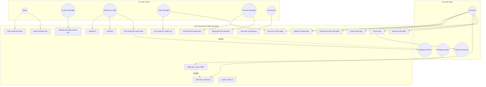

**Ghi chú quan hệ:**
- `UC15 (Nhận đơn từ sàn)` **include** `UC4 (Đặt hàng)` — vì đơn từ sàn cũng đi qua luồng giữ chỗ tồn kho như đơn nội bộ.
- `UC4 (Đặt hàng)` **extend** bởi khả năng áp dụng `UC16 (Khuyến mãi)`.

---

## 4. ĐẶC TẢ CHI TIẾT USE CASE

### UC-04: Đặt hàng / Checkout

| Mục | Nội dung |
|---|---|
| **Mã use case** | UC-04 |
| **Tên** | Đặt hàng (Checkout) |
| **Actor chính** | Customer |
| **Actor phụ** | Hệ thống Redis (giữ chỗ tồn kho), Celery Worker |
| **Mô tả** | Khách hàng xác nhận giỏ hàng, hệ thống giữ chỗ tồn kho tức thời và tạo đơn hàng ở trạng thái chờ xác nhận |
| **Điều kiện tiên quyết** | Khách đã đăng nhập; giỏ hàng có ít nhất 1 sản phẩm; sản phẩm đang ở trạng thái `active` |
| **Điều kiện kết thúc (thành công)** | Đơn hàng được tạo với status = `pending_confirm`; tồn kho tạm thời (Redis) đã bị trừ tương ứng |
| **Điều kiện kết thúc (thất bại)** | Không có đơn nào được tạo; tồn kho không đổi |
| **Luồng chính** | 1. Khách nhấn "Đặt hàng" 2. Hệ thống kiểm tra Idempotency-Key 3. Hệ thống trừ tạm tồn kho (Redis) cho từng SKU 4. Hệ thống tạo bản ghi Order + OrderItem 5. Hệ thống đẩy tác vụ xác nhận đơn vào hàng đợi (Celery) 6. Hệ thống phản hồi thành công cho khách |
| **Luồng thay thế** | 3a. Nếu 1 SKU không đủ hàng → hoàn tác các SKU đã trừ trước đó, trả lỗi "hết hàng", dừng luồng 2a. Nếu Idempotency-Key đã tồn tại → trả lại kết quả đơn hàng cũ, không tạo trùng |
| **Quy tắc nghiệp vụ liên quan** | BR-01, BR-02, BR-03 (xem mục 7) |

---

### UC-09: Nhập kho

| Mục | Nội dung |
|---|---|
| **Mã use case** | UC-09 |
| **Tên** | Nhập kho |
| **Actor chính** | Warehouse_Staff |
| **Actor phụ** | Admin (duyệt phiếu) |
| **Mô tả** | Nhân viên kho tạo phiếu nhập hàng từ nhà cung cấp, được duyệt, sau đó xác nhận hoàn tất để cộng số lượng vào tồn kho thực |
| **Điều kiện tiên quyết** | Người dùng có quyền `inventory.import`; nhà cung cấp và SKU đã tồn tại trong hệ thống |
| **Điều kiện kết thúc (thành công)** | `stock_imports.status = completed`; `inventory.quantity` tăng đúng số lượng nhập; có bản ghi `stock_movements` tương ứng; tồn kho mới được đồng bộ sang các kênh bán |
| **Luồng chính** | 1. Nhân viên kho tạo phiếu nhập (chọn NCC, SKU, số lượng, đơn giá) — status=`draft` 2. Người có quyền duyệt (`inventory.approve`) duyệt phiếu — status=`approved` 3. Khi hàng về kho thực tế, nhân viên xác nhận hoàn tất 4. Hệ thống mở transaction, khoá dòng tồn kho (`SELECT FOR UPDATE`), cộng số lượng 5. Ghi log biến động kho (`stock_movements`) 6. Commit transaction, đẩy tác vụ đồng bộ tồn kho sang kênh bán |
| **Luồng thay thế** | 2a. Người duyệt từ chối → status=`cancelled`, dừng luồng |
| **Quy tắc nghiệp vụ liên quan** | BR-04, BR-05 |

---

### UC-14: Đồng bộ tồn kho đa kênh

| Mục | Nội dung |
|---|---|
| **Mã use case** | UC-14 |
| **Tên** | Đồng bộ tồn kho đa kênh |
| **Actor chính** | Hệ thống (tự động, kích hoạt bởi UC-04, UC-09, UC-10) |
| **Actor phụ** | Shopee/Lazada API |
| **Mô tả** | Sau mỗi thay đổi tồn kho (bán, nhập, xuất), hệ thống tự động đẩy số lượng mới sang các kênh bán đang niêm yết SKU đó |
| **Điều kiện tiên quyết** | SKU có ít nhất 1 kênh `channel_products` đang active |
| **Điều kiện kết thúc (thành công)** | Tất cả kênh nhận được số lượng mới; `sync_status = synced` |
| **Điều kiện kết thúc (thất bại một phần)** | Kênh lỗi được đánh dấu `sync_status = out_of_sync`, ghi log lỗi, không ảnh hưởng các kênh còn lại |
| **Luồng chính** | 1. Nhận sự kiện thay đổi tồn kho (sku, số lượng mới) 2. Lấy danh sách kênh active bán SKU này 3. Với mỗi kênh, gọi API cập nhật tồn kho song song 4. Ghi log kết quả từng kênh |
| **Luồng thay thế** | 3a. Kênh timeout/lỗi → thử lại theo cơ chế exponential backoff (tối đa 5 lần) 3a-1. Hết số lần thử vẫn lỗi → đánh dấu `out_of_sync`, cảnh báo Channel_Manager |
| **Quy tắc nghiệp vụ liên quan** | BR-06, BR-07 |

---

### UC-15: Nhận đơn từ sàn TMĐT (Webhook)

| Mục | Nội dung |
|---|---|
| **Mã use case** | UC-15 |
| **Tên** | Nhận đơn hàng từ Shopee/Lazada |
| **Actor chính** | Shopee/Lazada (External System) |
| **Mô tả** | Sàn TMĐT gửi webhook khi có đơn hàng mới; hệ thống xác thực, chống trùng, rồi xử lý như một đơn hàng nội bộ |
| **Điều kiện tiên quyết** | Kênh đã được cấu hình hợp lệ (`channels.is_active = true`); request có chữ ký hợp lệ |
| **Điều kiện kết thúc (thành công)** | Đơn hàng nội bộ được tạo với `source = shopee/lazada`; phản hồi 200 OK cho sàn |
| **Điều kiện kết thúc (thất bại)** | Không tạo đơn; trả lỗi phù hợp (401 nếu sai chữ ký) |
| **Luồng chính** | 1. Nhận payload + chữ ký từ sàn 2. Xác thực chữ ký (HMAC) 3. Kiểm tra `external_order_id` đã xử lý chưa (chống trùng do sàn gọi lại webhook) 4. Parse đơn hàng, ánh xạ sang cấu trúc nội bộ 5. Thực hiện luồng giữ chỗ tồn kho (tương tự UC-04) 6. Phản hồi 200 OK ngay lập tức |
| **Luồng thay thế** | 2a. Sai chữ ký → trả 401, ghi log nghi vấn giả mạo 3a. `external_order_id` đã xử lý → trả 200 OK ngay, không xử lý lại |
| **Quy tắc nghiệp vụ liên quan** | BR-02, BR-08 |

---

### UC-07: Đánh giá sản phẩm

| Mục | Nội dung |
|---|---|
| **Mã use case** | UC-07 |
| **Tên** | Đánh giá sản phẩm |
| **Actor chính** | Customer |
| **Mô tả** | Khách hàng đánh giá (rating + bình luận) sản phẩm đã mua và đã nhận hàng |
| **Điều kiện tiên quyết** | Khách có đơn hàng chứa sản phẩm này ở trạng thái `delivered`; chưa từng đánh giá đơn hàng này cho sản phẩm này |
| **Điều kiện kết thúc (thành công)** | Bản ghi `review` được tạo với `status = pending`; điểm đánh giá trung bình sản phẩm được tính lại bất đồng bộ |
| **Luồng chính** | 1. Khách chọn sản phẩm trong đơn đã giao, viết đánh giá 2. Hệ thống kiểm tra điều kiện mua hàng + trạng thái đơn 3. Hệ thống kiểm tra chưa đánh giá trùng 4. Lưu đánh giá (chờ kiểm duyệt) 5. Đẩy tác vụ tính lại rating trung bình |
| **Luồng thay thế** | 2a. Chưa mua/chưa nhận hàng → từ chối, thông báo lý do 3a. Đã đánh giá đơn này rồi → từ chối |
| **Quy tắc nghiệp vụ liên quan** | BR-09 |

---

## 5. SƠ ĐỒ TUẦN TỰ (SEQUENCE DIAGRAM)

### 5.1. UC-01: Đăng ký / Đăng nhập + Refresh Token

**Actor:** Customer | **Precondition:** Chưa có phiên đăng nhập hợp lệ | **Postcondition:** Có access_token + refresh_token hợp lệ

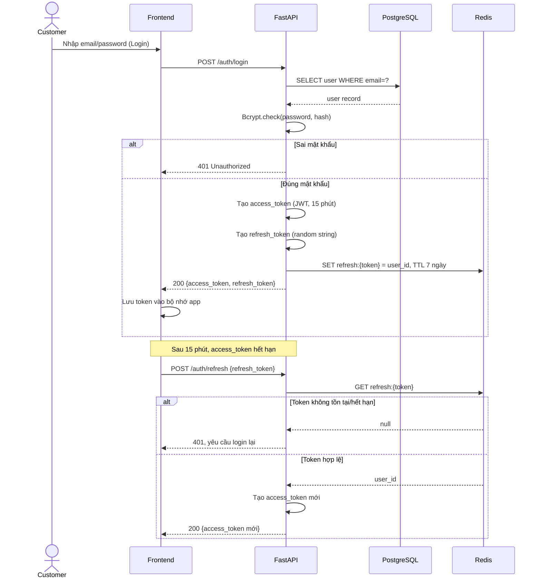

---

### 5.2. UC-04: Đặt hàng — Giữ chỗ tồn kho

**Actor:** Customer | **Precondition:** Giỏ hàng có sản phẩm, sản phẩm active | **Postcondition:** Order tạo với status=`pending_confirm`, Redis stock đã trừ tạm

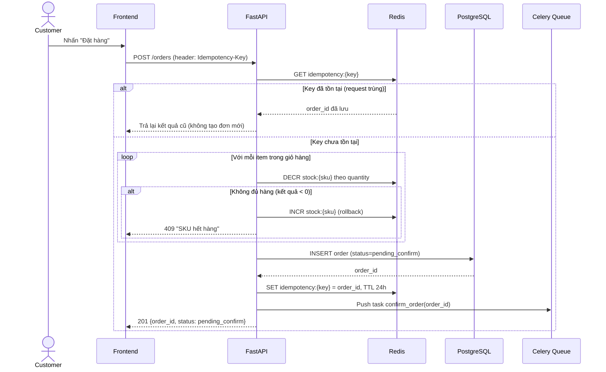

---

### 5.3. Celery Worker xác nhận đơn (trừ kho thật)

**Actor:** Hệ thống (bất đồng bộ) | **Precondition:** Order tồn tại với status=`pending_confirm` | **Postcondition:** Order status=`confirmed` hoặc `failed_out_of_stock`; `inventory.quantity` được cập nhật đúng

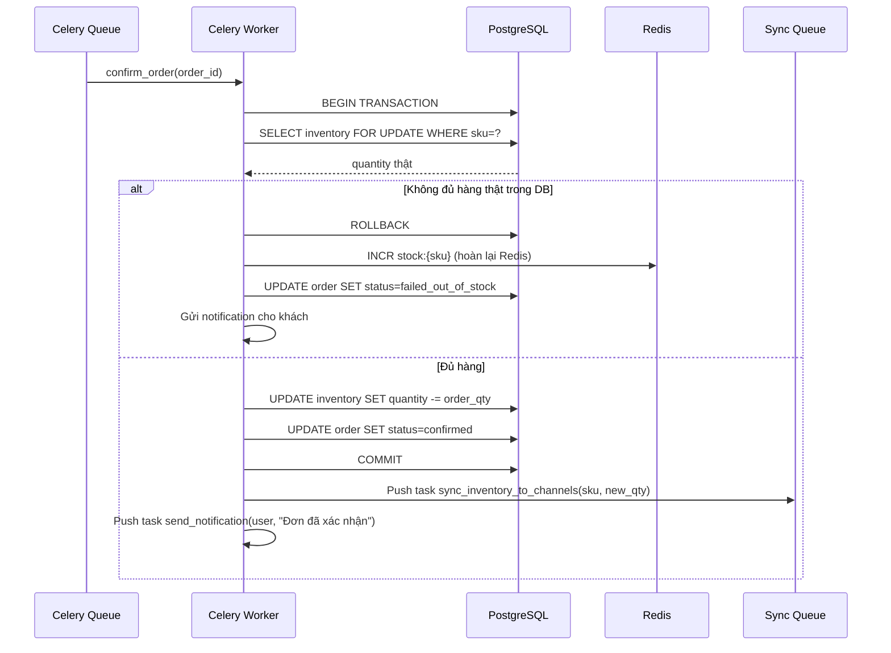

**Ghi chú kỹ thuật:** bước `SELECT ... FOR UPDATE` là cơ chế khoá dòng (pessimistic lock) của PostgreSQL, đảm bảo khi nhiều đơn cùng trừ 1 SKU đồng thời, các transaction được xử lý tuần tự — triệt tiêu race condition.

---

### 5.4. UC-14: Đồng bộ tồn kho sang Shopee/Lazada

**Actor:** Hệ thống | **Precondition:** Có thay đổi `inventory.quantity` | **Postcondition:** Các kênh active nhận số lượng mới hoặc được đánh dấu `out_of_sync`

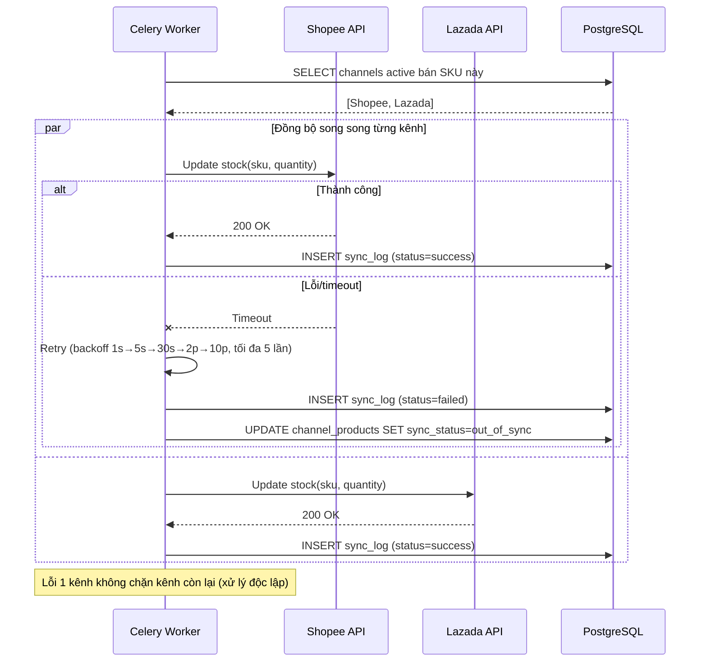

---

### 5.5. UC-15: Nhận Webhook đơn hàng từ Shopee

**Actor:** Shopee (External System) | **Precondition:** Kênh đã cấu hình active | **Postcondition:** Order nội bộ tạo với source=`shopee`, hoặc request bị từ chối nếu sai chữ ký

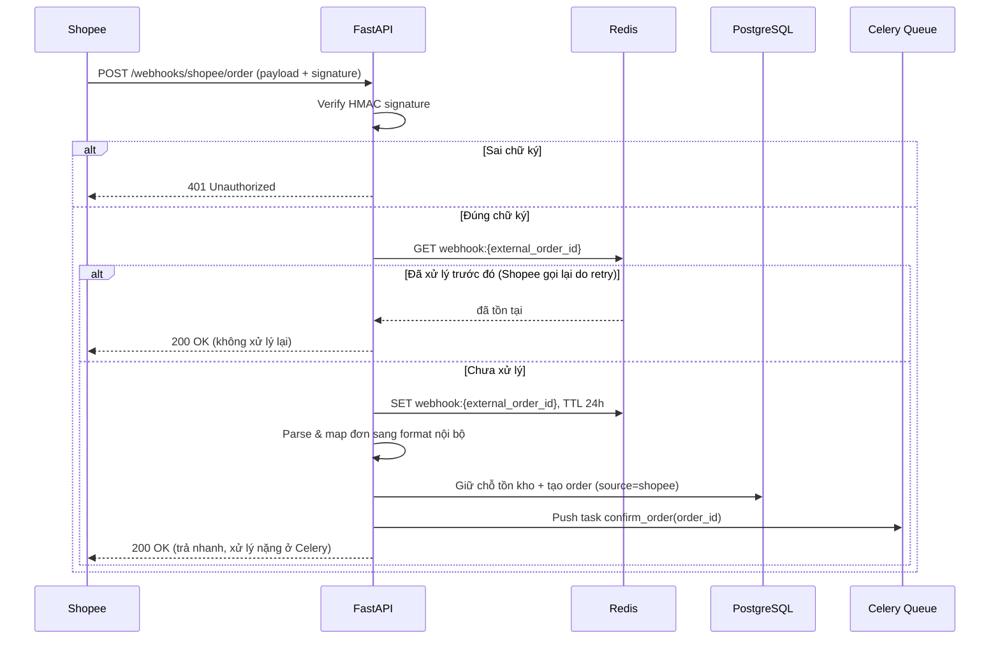

---

### 5.6. UC-05: Thanh toán + Callback

**Actor:** Customer, Payment Gateway | **Precondition:** Order status=`confirmed`, chưa thanh toán | **Postcondition:** Order status=`paid` (thành công) hoặc `payment_failed` + rollback tồn kho (thất bại)

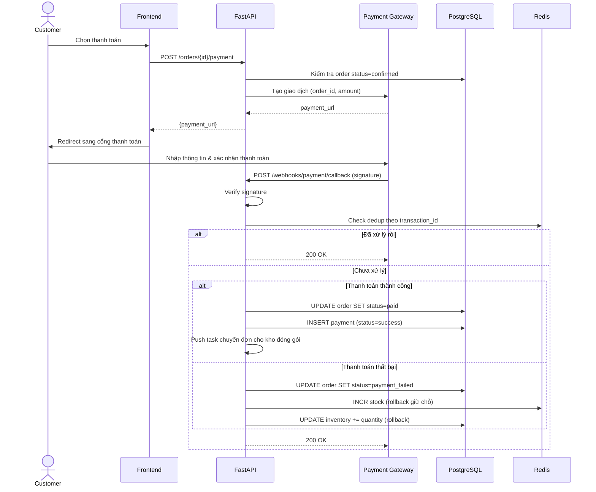

---

### 5.7. UC-09: Nhập kho (Warehouse Staff)

**Actor:** Warehouse_Staff, Admin (duyệt) | **Precondition:** SKU và nhà cung cấp đã tồn tại | **Postcondition:** `inventory.quantity` tăng, có bản ghi `stock_movements`

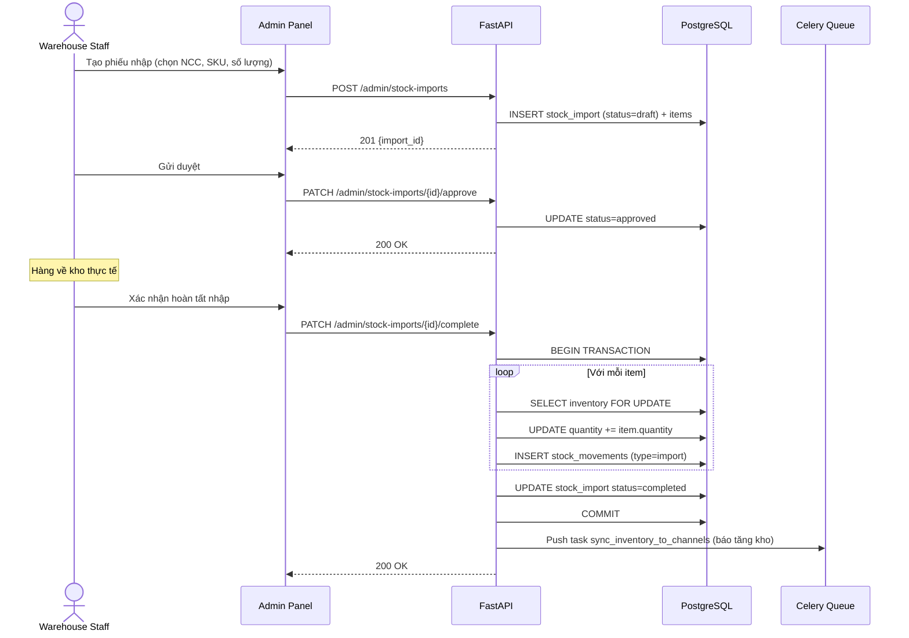

---

### 5.8. UC-07: Đánh giá sản phẩm

**Actor:** Customer | **Precondition:** Đơn hàng chứa sản phẩm ở status=`delivered` | **Postcondition:** Review tạo với status=`pending`, rating trung bình sản phẩm được lên lịch tính lại

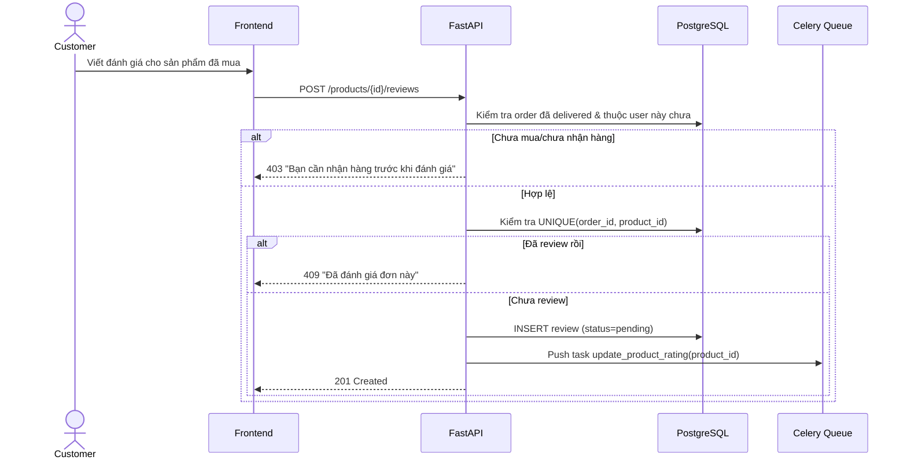

---

## 6. SƠ ĐỒ LỚP (CLASS DIAGRAM)

### 6.1. Nhóm Người dùng & Phân quyền

**Mô tả:** Lớp `User` là trung tâm xác thực của toàn hệ thống, đại diện cho cả khách hàng lẫn nhân viên nội bộ (phân biệt bằng thuộc tính `role`). Quan hệ nhiều-nhiều giữa `Role` và `Permission` cho phép mở rộng phân quyền linh hoạt mà không sửa code.

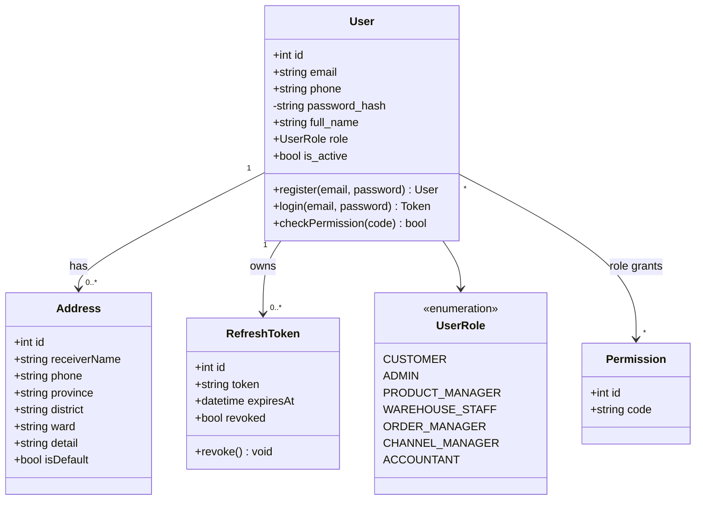

**Ràng buộc nghiệp vụ trên lớp:**
- `User.email` và `User.phone` phải duy nhất toàn hệ thống.
- `password_hash` không bao giờ trả về client (đánh dấu `private`).
- 1 `User` chỉ có tối đa 1 `Address` với `isDefault = true` tại một thời điểm.

---

### 6.2. Nhóm Sản phẩm & Tồn kho

**Mô tả:** `Product` là khái niệm trừu tượng (VD: "Áo thun nam"), còn `ProductVariant` mới là đơn vị thực sự có thể bán và theo dõi tồn kho (VD: "Áo thun nam - Đen - Size L"). `Inventory` tách riêng theo từng kho (`Warehouse`) để hỗ trợ nhiều kho vật lý.

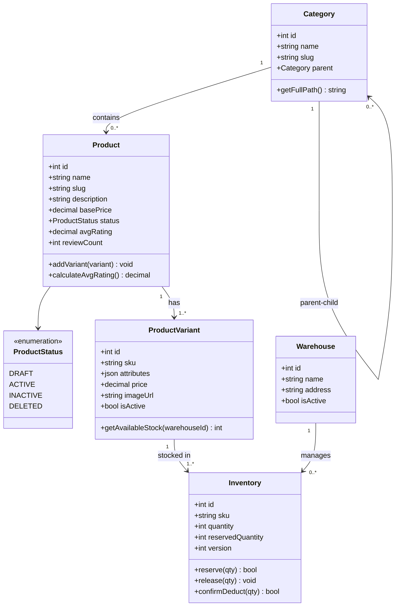

**Ràng buộc nghiệp vụ trên lớp:**
- `ProductVariant.sku` duy nhất toàn hệ thống (kể cả giữa các sản phẩm khác nhau).
- `Inventory.quantity - Inventory.reservedQuantity` = số lượng thực sự khả dụng để bán (`available stock`), không lưu thành cột riêng để tránh lệch dữ liệu.
- Một `Product` phải có ít nhất 1 `ProductVariant` mới được chuyển sang `status = active`.

---

### 6.3. Nhóm Đơn hàng & Giỏ hàng

**Mô tả:** `Cart` là trạng thái tạm thời trước khi đặt hàng; khi checkout thành công, dữ liệu được "đóng băng" (snapshot) vào `Order`/`OrderItem` — kể cả khi giá sản phẩm gốc thay đổi sau này, đơn hàng cũ vẫn giữ đúng giá tại thời điểm mua.

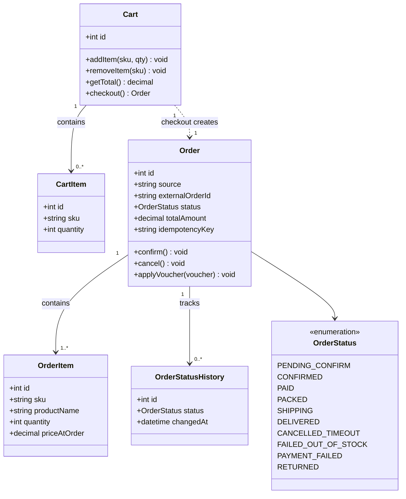

**Ràng buộc nghiệp vụ trên lớp:**
- `Order.idempotencyKey` duy nhất — đảm bảo 1 yêu cầu đặt hàng chỉ tạo đúng 1 đơn dù client gửi lại nhiều lần.
- Mọi thay đổi `Order.status` đều phải ghi vào `OrderStatusHistory` (audit trail).
- `OrderItem.priceAtOrder` là snapshot, không tham chiếu động đến `ProductVariant.price`.

---

### 6.4. Nhóm Thanh toán, Vận chuyển & Đa kênh

**Mô tả:** `Channel` đóng vai trò adapter kết nối tới hệ thống ngoài (Shopee/Lazada), có thể tạo `Order` (qua webhook) hoặc nhận lệnh cập nhật tồn kho từ hệ thống nội bộ.

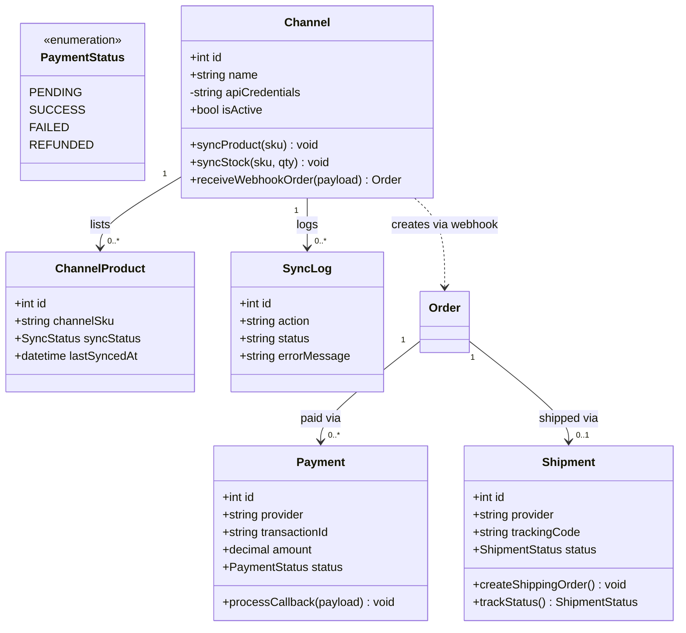

**Ràng buộc nghiệp vụ trên lớp:**
- `Payment.transactionId` duy nhất — chống ghi nhận trùng khi cổng thanh toán gọi callback nhiều lần.
- `apiCredentials` của `Channel` phải mã hoá khi lưu trữ (đánh dấu `private`).
- 1 `Order` có thể có nhiều `Payment` (trường hợp retry thanh toán) nhưng chỉ 1 `Payment.status = success` được chấp nhận.

---

### 6.5. Nhóm Nhập/Xuất kho & Nhân sự

**Mô tả:** `StockMovement` là lớp "sổ cái" (ledger) ghi lại mọi biến động tồn kho bất kể nguyên nhân (nhập, xuất, bán, huỷ) — phục vụ truy vết khi có sai lệch số liệu. `Employee` tách biệt khỏi `User` để lưu thông tin nhân sự thực tế (không phải mọi `User` đều là `Employee`).

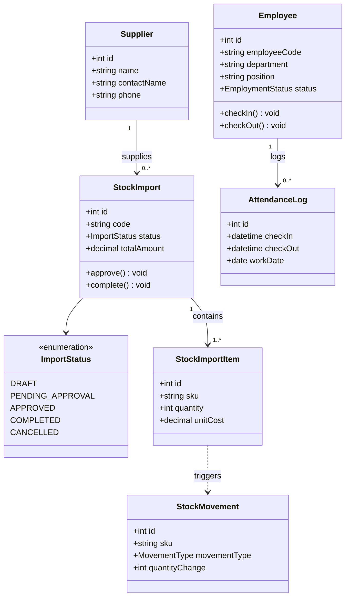

**Ràng buộc nghiệp vụ trên lớp:**
- `StockImport.complete()` chỉ được gọi khi `status = approved`.
- Mỗi `StockImportItem` khi hoàn tất nhập phải sinh đúng 1 bản ghi `StockMovement` tương ứng (`movementType = import`).
- `Employee.userId` là khoá ngoại duy nhất (1-1) tới `User`.

---

### 6.6. Nhóm Khuyến mãi & Đánh giá

**Mô tả:** `Voucher` áp dụng theo mô hình kiểm tra-rồi-trừ trong cùng transaction với tạo đơn để tránh vượt hạn mức sử dụng khi nhiều khách cùng dùng 1 mã. `Review` ràng buộc chặt với `Order` để đảm bảo chỉ người đã mua mới đánh giá được.

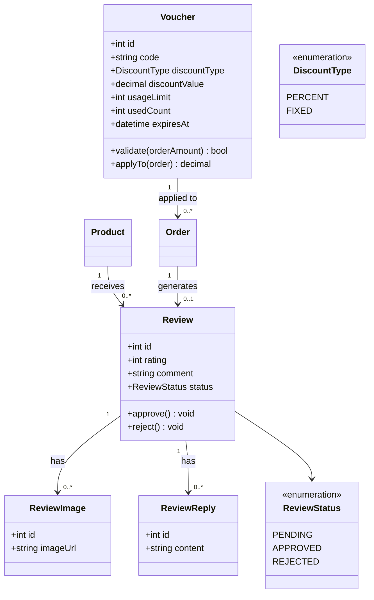

**Ràng buộc nghiệp vụ trên lớp:**
- `Voucher.usedCount` chỉ tăng trong cùng transaction với tạo `Order` — nếu tạo đơn thất bại, `usedCount` phải rollback theo.
- 1 `Order` chỉ tạo tối đa 1 `Review` cho mỗi `Product` bên trong nó (ràng buộc unique `order_id + product_id`).

---

## 7. QUY TẮC NGHIỆP VỤ TỔNG HỢP (BUSINESS RULES)

| Mã | Quy tắc |
|---|---|
| **BR-01** | Mọi yêu cầu tạo đơn hàng phải mang `Idempotency-Key`; hệ thống từ chối xử lý trùng dựa trên key này trong vòng 24 giờ. |
| **BR-02** | Tồn kho được giữ chỗ 2 lớp: Redis (tức thời, atomic) để phản hồi nhanh cho khách, PostgreSQL (`SELECT FOR UPDATE`) là nguồn sự thật cuối cùng khi Celery xác nhận đơn. |
| **BR-03** | Đơn hàng ở trạng thái `pending_confirm` quá 30 phút chưa thanh toán sẽ tự động bị huỷ (`cancelled_timeout`) và hoàn tồn kho. |
| **BR-04** | Phiếu nhập kho (`StockImport`) bắt buộc qua bước duyệt (`approved`) trước khi được xác nhận hoàn tất và cộng vào tồn kho thực. |
| **BR-05** | Mọi thay đổi số lượng tồn kho (nhập, xuất, bán, huỷ) đều phải sinh 1 bản ghi `StockMovement` — không cho phép sửa trực tiếp `Inventory.quantity` mà không qua log. |
| **BR-06** | Đồng bộ tồn kho sang từng kênh bán được xử lý độc lập; lỗi ở 1 kênh không được chặn hoặc làm chậm việc đồng bộ các kênh còn lại. |
| **BR-07** | Khi đồng bộ tồn kho ra kênh ngoài thất bại sau tối đa 5 lần thử lại (exponential backoff), hệ thống phải đánh dấu `out_of_sync` và cảnh báo cho Channel_Manager xử lý thủ công. |
| **BR-08** | Mọi webhook nhận từ hệ thống ngoài (Shopee/Lazada/Payment Gateway) đều phải xác thực chữ ký (HMAC) trước khi xử lý; yêu cầu sai chữ ký bị từ chối ngay (401). |
| **BR-09** | Khách hàng chỉ được đánh giá sản phẩm khi có đơn hàng chứa sản phẩm đó ở trạng thái `delivered`, và chỉ đánh giá 1 lần cho mỗi cặp (đơn hàng, sản phẩm). |
| **BR-10** | Việc áp dụng `Voucher` (kiểm tra hạn mức + tăng `used_count`) phải nằm trong cùng transaction với việc tạo `Order`, đảm bảo tính nhất quán khi nhiều khách cùng dùng 1 mã giảm giá đồng thời. |
| **BR-11** | Mật khẩu người dùng luôn được băm bằng Bcrypt trước khi lưu; không bao gigiờ lưu hoặc trả về plaintext. |
| **BR-12** | Access token (JWT) có hạn ngắn (15 phút); refresh token lưu trong Redis để có thể thu hồi (revoke) ngay khi người dùng đăng xuất hoặc tài khoản bị khoá. |

---

## 8. MA TRẬN TRUY VẾT

Bảng dưới thể hiện mối liên kết giữa Use Case — Sequence Diagram — Class Diagram liên quan, giúp truy vết khi cần sửa đổi thiết kế.

| Use Case | Sequence Diagram | Class Diagram liên quan | Business Rules |
|---|---|---|---|
| UC-01 Đăng ký/Đăng nhập | 5.1 | 6.1 (User, RefreshToken) | BR-11, BR-12 |
| UC-04 Đặt hàng | 5.2, 5.3 | 6.2 (Inventory), 6.3 (Order, OrderItem) | BR-01, BR-02, BR-03 |
| UC-05 Thanh toán | 5.6 | 6.4 (Payment) | BR-02, BR-08 |
| UC-07 Đánh giá sản phẩm | 5.8 | 6.6 (Review) | BR-09 |
| UC-09 Nhập kho | 5.7 | 6.5 (StockImport, StockMovement) | BR-04, BR-05 |
| UC-14 Đồng bộ tồn kho đa kênh | 5.4 | 6.4 (Channel, SyncLog) | BR-06, BR-07 |
| UC-15 Nhận đơn từ sàn | 5.5 | 6.3 (Order), 6.4 (Channel) | BR-01, BR-02, BR-08 |

---

**Phụ lục tham chiếu:** Chi tiết schema SQL đầy đủ (`schema.sql`) và sơ đồ ERD (`uml-erd.md`) đã được cung cấp ở tài liệu trước — tài liệu này bổ sung phần hành vi (behavior) và tương tác (interaction) mà ERD không thể hiện được.